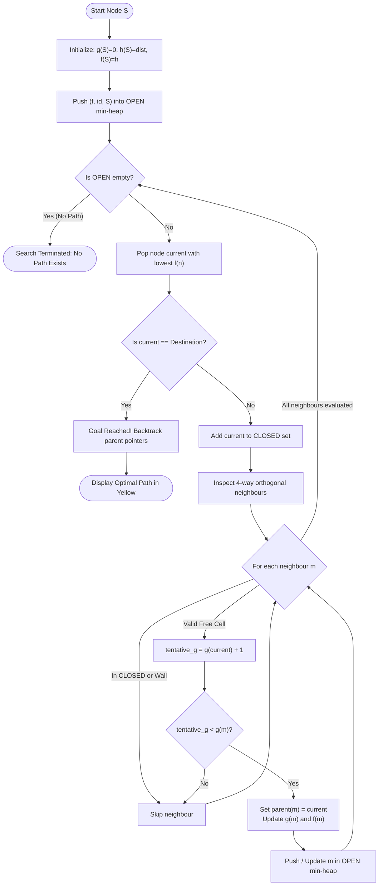

# 🏭 Warehouse Delivery Route Planner (Live A* Search)

<p align="center">
  
  
  
  
</p>

An interactive, visual AI pathfinding application simulating an **Automated Guided Vehicle (AGV)** navigating an obstacle-dense warehouse floor using the **A\* (A-Star) Search Algorithm**.

Designed as an educational demonstration tool for **Artificial Intelligence (AI) / Fundamentals of AI (FAI)** coursework, this application enables teachers and students to inspect, step through, and analyze heuristic search and path optimization in real time.

---

## 📑 Table of Contents
1. [Project Overview & Problem Statement](#-1-project-overview--problem-statement)
2. [Mathematical & Algorithmic Foundations](#-2-mathematical--algorithmic-foundations)
3. [Algorithm Flowchart & Decision Logic](#-3-algorithm-flowchart--decision-logic)
4. [Architecture & Data Structures](#-4-architecture--data-structures)
5. [Graphical Interface & Visual Legend](#-5-graphical-interface--visual-legend)
6. [Controls & User Guide](#-6-controls--user-guide)
7. [System Requirements & Installation](#-7-system-requirements--installation)
8. [Teacher / Examiner Demonstration Guide (Viva Voce Prep)](#-8-teacher--examiner-demonstration-guide-viva-voce-prep)
9. [Theoretical Complexity & Viva Voce Q&A](#-9-theoretical-complexity--viva-voce-qa)
10. [Repository Structure & Metadata](#-10-repository-structure--metadata)

---

## 📌 1. Project Overview & Problem Statement

### 1.1 Problem Statement
In automated warehousing (such as Amazon Robotics fulfillment centers and automated supply chains), Autonomous Mobile Robots (AMRs) and Automated Guided Vehicles (AGVs) transport pallets between staging bays and drop-off stations. The environment consists of storage racks, narrow transit aisles, and dynamic blockages.

The objective is to compute the **optimal (minimum-cost) collision-free route** from the robot's starting bay to its assigned delivery point while minimizing computational overhead (number of explored nodes).

### 1.2 Core Objectives
- **Demonstrate Heuristic Search**: Move beyond abstract equations by visualizing how $f(n) = g(n) + h(n)$ guides the search towards the goal.
- **Provide Step-by-Step Transparency**: Every single node expansion, neighbour evaluation, edge relaxation, and queue update is traced in real time.
- **Interactive Experimentation**: Allow users to alter obstacles, randomize layouts, step forward manually, and observe how heuristic pruning responds to bottlenecks and dead ends.

---

## 🧠 2. Mathematical & Algorithmic Foundations

The application implements the standard **A\* Search Algorithm** on a 2D discrete grid graph $G = (V, E)$.

### 2.1 The Evaluation Function
At each node $n$, A\* calculates:

$$f(n) = g(n) + h(n)$$

| Term | Formal Definition | Role in Pathfinding |
| :--- | :--- | :--- |
| **$g(n)$** | **Exact Path Cost** | Cumulative cost from Start $S$ to node $n$. Moving 1 orthogonal step has uniform cost $c(u, v) = 1$. |
| **$h(n)$** | **Heuristic Estimate** | Estimated cost from node $n$ to Goal $D$. Guides the search forward. |
| **$f(n)$** | **Total Estimated Cost** | Estimated total cost of the cheapest solution passing through node $n$. |

### 2.2 Heuristic Function: Manhattan Distance
Because robot movement is constrained to 4 cardinal directions (Up, Down, Left, Right) without diagonal traversal, the **Manhattan Distance ($L_1$ norm)** is employed:

$$h(n) = |r_n - r_{goal}| + |c_n - c_{goal}|$$

> [!NOTE]
> **Optimality Guarantees:**
> 1. **Admissibility ($h(n) \le h^*(n)$)**: In an empty grid, the true minimum cost between $(r_n, c_n)$ and $(r_g, c_g)$ with 4-way movement is strictly equal to the Manhattan distance. Obstacle shelves can only lengthen or maintain the true cost ($h^*(n) \ge h(n)$). Because $h(n)$ never overestimates the true remaining cost, **A\* is guaranteed to find an optimal (shortest) path**.
> 2. **Consistency / Monotonicity**: For any adjacent nodes $n$ and $n'$, the triangle inequality holds: $h(n) \le c(n, n') + h(n')$. Since $c(n, n') = 1$ and $|h(n) - h(n')| \le 1$, consistency is guaranteed. Once a node enters the `CLOSED` set, the discovered path to it is strictly minimal, preventing costly node re-expansions.

### 2.3 Neighbour Evaluation Decisions
During node expansion, each adjacent non-wall cell is classified into one of four states:

```
                      Adjacent Cell Evaluation
                                  │
                  ┌───────────────┴───────────────┐
             In CLOSED?                      Not in CLOSED
                  │                               │
             ┌────┴────┐                  ┌───────┴───────┐
            YES        NO           tentative_g < g(m)?  tentative_g >= g(m)
             │         │                  │               │
         [CLOSED]      │                 YES              NO
         (Ignored)     │                  │               │
                       │           ┌──────┴──────┐    [KEEP OLD]
                       │        In OPEN?      Not in   (Ignored)
                       │           │          OPEN?
                       │          YES           │
                       │           │           YES
                       │       [UPDATE]         │
                       │       (Relax)        [ADD]
                       │                   (Discovered)
```

- **`ADD`**: A previously unvisited node is discovered; its $g$, $h$, and $f$ scores are recorded, and it is pushed onto the `OPEN` priority queue.
- **`UPDATE` (Edge Relaxation)**: A lower $g$-cost route to an already queued node is discovered. Its parent pointer and scores are updated.
- **`CLOSED`**: The neighbour has already been expanded and finalized; it is skipped.
- **`KEEP OLD`**: The neighbour is reachable via the current path, but the existing recorded route is equal or shorter.

---

## 🔄 3. Algorithm Flowchart & Decision Logic



---

## 🏗️ 4. Architecture & Data Structures

The application relies strictly on Python's built-in standard libraries (`heapq`, `tkinter`, `itertools`), avoiding external dependencies while ensuring optimal asymptotic performance:

```
d:/fai/
│
├── warehouse.py
│   ├── Grid Engine        -> 15 x 20 2D Matrix (Cartesian indexing)
│   ├── Priority Queue     -> heapq min-heap storing (f, tie_breaker, cell)
│   ├── State Sets         -> open_nodes (set), closed_nodes (set), walls (set)
│   ├── Parent Map         -> child-to-parent dictionary for route backtracking
│   └── GUI View           -> Event-driven Tkinter Canvas with real-time HUD
```

### Core Data Structures
| Structure | Python Type | Time Complexity | Purpose |
| :--- | :--- | :---: | :--- |
| `frontier` | `heapq` (Min-Heap) | $O(\log N)$ push/pop | Priority queue prioritizing nodes with the lowest $f(n)$ value. |
| `open_nodes` | `set` | $O(1)$ lookup | Set representation of the frontier for constant-time membership tests. |
| `closed_nodes` | `set` | $O(1)$ lookup | Set of finalized cells to prevent redundant cycles and re-evaluations. |
| `parent` | `dict` | $O(1)$ read/write | Directed parent pointers (`node -> parent`) used for route backtracking. |
| `g_score`, `f_score` | `dict` | $O(1)$ read/write | Hash tables tracking exact costs and total estimates for each grid cell. |
| `walls` | `set` | $O(1)$ collision check | Coordinates of storage shelves acting as obstacles. |

---

## 🎨 5. Graphical Interface & Visual Legend

The application utilizes an ergonomic, high-contrast dark theme designed for classroom projector clarity and personal study.

### 5.1 Canvas Color Legend
| Indicator | Color | Hex | Component | Description |
| :---: | :---: | :---: | :--- | :--- |
| 🟩 | Green | `#22c55e` | **Start (S)** | Fixed AGV depot / starting bay `(1, 1)` |
| 🟥 | Red | `#ef4444` | **Destination (D)** | Parcel drop-off destination `(13, 18)` |
| ⬛ | Slate | `#334155` | **Shelf / Obstacle** | Impassable warehouse rack blocks |
| 🟪 | Purple | `#c084fc` | **Current Node** | Cell currently popped from `OPEN` and undergoing expansion |
| 🟧 | Orange | `#fb923c` | **Neighbours** | Candidate adjacent cells currently being evaluated |
| 🟦 | Blue | `#93c5fd` | **OPEN List** | Discovered frontier cells waiting to be explored |
| ⬜ | Grey | `#cbd5e1` | **CLOSED List** | Fully expanded cells |
| 🟨 | Yellow | `#fbbf24` | **Final Route** | Backtracked optimal shortest path from Start to Destination |
| ╌╌ | Dashed | `#64748b` | **Parent Links** | Dotted lines illustrating the expanding search tree |

### 5.2 Diagnostic Side Panel (Live Telemetry)
The right-hand panel gives complete diagnostic insight into the algorithm's internal state:
1. **Search Trace Step**: Tracks total iterations and the current search phase (`Step N`).
2. **Current Node Telemetry**: Displays the active coordinates $(r, c)$ alongside exact values for $g(n)$, $h(n)$, and $f(n)$.
3. **Neighbour Evaluation Log**: Tabular breakdown showing tentative $g$, $h$, $f$ and decision outcomes (`ADD`, `UPDATE`, `CLOSED`, or `KEEP OLD`).
4. **OPEN List Priority View**: Live inspection showing upcoming candidate cells sorted by lowest $f$-score.
5. **Aggregate Metrics**: Live counts of expanded nodes, size of `OPEN`, and size of `CLOSED`.

---

## 🕹️ 6. Controls & User Guide

| Button / Control | Key Function | Recommended Use |
| :--- | :--- | :--- |
| **RUN LIVE A\*** | Initiates continuous automatic step-by-step search. | Observing overall heuristic guidance. |
| **STEP ONCE** | Advances the search by **exactly one** node expansion. | Academic presentations, oral exams, and code defense. |
| **PAUSE** | Freezes live animation instantly. | Inspecting live scores and discussing edge cases. |
| **SHOW FINAL PATH** | Highlights the optimal path in yellow using back-pointers. | Visualizing the final solution after goal selection. |
| **RANDOM SHELVES** | Generates a randomized obstacle layout (~16% density). | Testing algorithm adaptability on varied topologies. |
| **RESET** | Restores the default 6-block warehouse shelf layout. | Returning to a clean baseline state. |
| **Animation delay Slider** | Dynamically scales speed from 60 ms to 900 ms per step. | Speeding up exploration or slowing down for inspection. |
| **Grid Left-Click** | Toggle a shelf/obstacle on any cell (except S and D). | Custom maze design and bottleneck testing. |
| **Escape (Esc)** | Toggles fullscreen mode on/off. | Projector displays and lecture presentations. |

---

## ⚙️ 7. System Requirements & Installation

This project is built purely on Python's core libraries. **No `pip install` commands or virtual environments are required.**

### Prerequisites
- **Python 3.8+** (compatible with Python 3.8, 3.9, 3.10, 3.11, 3.12, 3.13)
- **Tkinter** (included by default in official Python distributions for Windows and macOS)

### Running the Application

1. Open your terminal or Command Prompt in the project folder:
   ```bash
   cd d:/fai
   ```

2. Launch the application:
   ```bash
   python warehouse.py
   ```

---

## 🎓 8. Teacher / Examiner Demonstration Guide (Viva Voce Prep)

When presenting this project for an evaluation, viva, or course project review, follow this structured walkthrough:

### 🚶 Step 1: Explain the Industrial Context
> *"This project models an Automated Guided Vehicle (AGV) in a smart logistics warehouse. The green cell (S) is the robot bay, the red cell (D) is the delivery point, and dark blocks represent warehouse shelf aisles."*

### 🚶 Step 2: Demonstrate Single-Step Expansion (`STEP ONCE`)
1. Click **`RESET`**, then click **`STEP ONCE`** 3 to 4 times.
2. Direct the teacher's attention to the **Side Panel**:
   - Point out the active coordinate $(r, c)$ and its $g$, $h$, and $f$ values.
   - Show how the algorithm explores neighbors in 4 directions, calculates tentative $g(n) = g(\text{current}) + 1$, evaluates Manhattan distance $h(n)$, and pushes candidates to `OPEN`.
   - Show the dashed parent links pointing back toward the source node.

### 🚶 Step 3: Run Live Search & Highlight Heuristic Directness
1. Set the animation delay slider to ~150–250 ms.
2. Click **`RUN LIVE A*`**.
3. Point out how the search is directed toward the destination (bottom-right) rather than expanding uniformly in all directions like Dijkstra or BFS. This proves the heuristic $h(n)$ is successfully guiding the search.

### 🚶 Step 4: Show Final Path Reconstruction
1. Once the destination is selected, click **`SHOW FINAL PATH`**.
2. Explain how the optimal trajectory (yellow path) is reconstructed in $O(L)$ time by starting at the goal and following parent references back to the start node.

### 🚶 Step 5: Test Obstacle Avoidance & Dead Ends
1. Click on the grid to create a wall closing an aisle or trapping a pathway.
2. Click **`RUN LIVE A*`** to show how A\* detects the dead end, leaves it in `CLOSED`, and backtracks to expand alternative candidate paths in the `OPEN` queue.

---

## 📊 9. Theoretical Complexity & Viva Voce Q&A

### 9.1 Computational Complexity
- **Time Complexity**:
  - **Worst Case**: $O(b^d)$, where $b$ is the branching factor ($b \le 4$) and $d$ is the solution depth.
  - **With Consistent Heuristic**: Each state is expanded at most once. For a grid with $|V|$ accessible cells, heap operations take $O(\log |V|)$, resulting in an upper bound of $O(|V| \log |V|)$.
- **Space Complexity**:
  - $O(|V|)$, as all discovered nodes and explored states reside in memory within the `frontier` (`OPEN`) and `closed_nodes` (`CLOSED`).

### 9.2 Viva Voce Frequently Asked Questions

<details>
<summary><b>Q1: Why use Manhattan Distance instead of Euclidean Distance?</b></summary>
<br>

Because movement on this warehouse grid is restricted to the 4 orthogonal directions (horizontal and vertical). While Euclidean distance $\sqrt{\Delta x^2 + \Delta y^2}$ is admissible, Manhattan distance $|\Delta x| + |\Delta y|$ is tighter (more informed) for 4-connected grids while remaining strictly admissible and consistent ($h_{\text{Euclidean}} \le h_{\text{Manhattan}} \le h^*$). A more informed heuristic prunes more unneeded branches, expanding fewer nodes.
</details>

<details>
<summary><b>Q2: What is the difference between A*, Dijkstra's Algorithm, and Greedy Best-First Search?</b></summary>
<br>

- **Dijkstra's Algorithm**: Considers only $g(n)$ ($h(n) = 0$). Guarantees shortest path, but expands uniformly in all directions (blind search).
- **Greedy Best-First Search**: Considers only $h(n)$ ($g(n) = 0$). Runs fast towards the goal, but does not guarantee the shortest path.
- **A\* Search**: Combines both ($f(n) = g(n) + h(n)$). Balances path cost so far with estimated remaining cost, guaranteeing the shortest path with fewer node expansions.
</details>

<details>
<summary><b>Q3: What guarantees that the discovered path is truly optimal?</b></summary>
<br>

A\* search on a graph is mathematically guaranteed to return the optimal path when the heuristic function is both **admissible** (never overestimates the true remaining cost to the goal) and **consistent** (satisfies the triangle inequality $h(n) \le c(n, n') + h(n')$). Because our edge cost is 1 and movement is 4-way, Manhattan distance is both admissible and consistent.
</details>

<details>
<summary><b>Q4: How does tie-breaking work in the OPEN priority queue?</b></summary>
<br>

When multiple nodes share the identical lowest $f$-score, Python's `heapq` compares the second element of the stored tuple: `(f_score, counter, cell)`. The `counter` is generated by `itertools.count()`, acting as a deterministic FIFO tie-breaker that prevents comparison errors between coordinate tuples.
</details>

<details>
<summary><b>Q5: What happens if there is no valid path to the destination?</b></summary>
<br>

If shelves completely wall off the start bay or destination, A\* systematically exhausts all reachable nodes. When the `OPEN` list becomes empty without reaching the destination, the algorithm cleanly terminates, updates the status panel to *"Search finished — no route"*, and prompts the user to edit obstacles and reset.
</details>

---

## 📁 10. Repository Structure & Metadata

```
d:/fai/
│
├── warehouse.py     # Main application file containing the GUI and A* engine
└── README.md        # Comprehensive technical documentation & presentation guide
```

### Academic Metadata
- **Course**: Fundamentals of Artificial Intelligence (FAI)
- **Topic**: Informed Search Strategies & Pathfinding (A\* Search)
- **Domain**: Warehouse Automation / Robotics / Logistics (Industry 4.0)
- **Language**: Python 3 (Tkinter, Heapq)